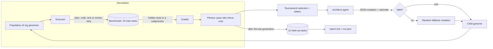

# evorg: self-evolving agent organizations

[](https://github.com/AkshayTallikar/evolving-agent-org/actions/workflows/ci.yml)

A team of LLM agents (planner, coder, tester, reviewer) solves coding tasks. An **architect
agent** reads how the team did and proposes a change to the team itself: add or drop a role,
rewrite an instruction, move a role to a bigger model, allow another retry. A benchmark
tournament with executed tests decides which version survives. Over generations the
organization redesigns itself, and every change is recorded with the architect's reason.

**Result so far (simulated models):** over 10 runs on a 36-task benchmark, evolved teams pass
63% to 70% of the 12 held-out tasks, against 30% for the starting single-coder team. The gain
of about 32 points has a 95% interval that excludes zero. See [Results, honestly](#results-honestly).

## The problem

Most multi-agent systems are designed by hand. Someone decides there should be a planner and
a reviewer, writes their prompts, and hopes the structure fits the work. Nobody measures
whether the reviewer earns its cost, or whether a prompt line is quietly making things worse.

evorg treats the organization as a genome and lets selection answer those questions:

- **Structure is searchable.** Roles, instructions, model tiers and retry budgets are all genes.
- **Fitness is measured, not judged.** Code is graded by running hidden tests, and cost
  counts against fitness (`fitness = pass rate - 10 x mean USD per task`).
- **Generalization is checked.** Twelve held-out tasks are never used for selection.
- **Every change is explained.** Lineage keeps what changed and why the architect proposed it.

## Architecture



| Module | What it does |
| --- | --- |
| `genome.py` | Immutable org genome, validation, content-hash id, diffs between genomes |
| `llm/` | `LLMBackend` protocol, an offline deterministic simulator, and an Anthropic backend |
| `bench/` | 36 small Python tasks (24 train, 12 held-out) with visible and hidden tests, and a subprocess grader |
| `executor.py` | Runs one organization on one task: planners, coder, then tester or reviewer, with retries on feedback |
| `mutation.py` | Seven mutation operators and the architect, which parses LLM output leniently |
| `evolution.py` | Tournament selection, elitism, an evaluation cache, held-out scoring |
| `crossover.py` | Role-aligned crossover between two organizations |
| `stats.py` | Seeded bootstrap confidence intervals for means and paired differences |
| `pareto.py` | NSGA-II style ranking on pass rate and cost |
| `report.py`, `cli.py` | Markdown run report and the `evorg` command |
| `web/` | FastAPI API and a React lineage explorer for saved runs |

The full design, with module contracts and the testing strategy, is in
[docs/design.md](docs/design.md).

## Run it

Needs Python 3.11 or newer.

```bash
git clone https://github.com/AkshayTallikar/evolving-agent-org.git
cd evolving-agent-org
pip install -e ".[dev]"

# evolve on the offline simulator (free, deterministic, a few seconds)
evorg run --backend sim --generations 8 --population 8 --seed 3

# score each genome over 3 simulator seeds (less luck, 3x the work)
evorg run --backend sim --generations 8 --population 8 --seed 3 --eval-seeds 3

# grade up to 4 tasks at once (about 1.9x faster on 4 cores, same results)
evorg run --backend sim --generations 8 --population 8 --seed 3 --workers 4

# grading results are cached in process (the simulator resubmits the same code a lot).
# Set EVORG_GRADE_CACHE=0 to turn the cache off; results are identical either way.
EVORG_GRADE_CACHE=0 evorg run --backend sim --generations 8 --population 8 --seed 3

# re-render a saved run
evorg show runs/sim-seed3

# score one genome on a split
evorg bench examples/seed_genome.json --split holdout

# what is each gene of a run's champion worth? remove or revert one at a time
evorg ablate runs/sim-seed3 --seeds 3 --out runs/sim-seed3/ablation.md

pytest          # runs offline, no API key needed
```

To browse runs as a family tree, install the web extra and serve the runs folder. Click any
organization to see its roles, scores, the architect's reason for the change and the diff
from its parent. Below the tree, a chart plots every evaluated organization by pass rate and
mean cost per task, draws the Pareto frontier and marks the champion; clicking a point selects it.

```bash
pip install -e ".[web]"
evorg serve --runs-dir runs      # then open http://127.0.0.1:8000
```

To evolve with real Claude models (small tier is Haiku, large tier is Opus), install the extra
and set `ANTHROPIC_API_KEY`. This spends money, so the command refuses to start without `--yes`
and a `--max-usd` cap. The cap is enforced before every call, architect included. Estimate first:

```bash
pip install -e ".[anthropic]"
evorg estimate --generations 3 --population 4
evorg run --backend anthropic --generations 3 --population 4 --max-usd 5 --yes
```

## Demo

`evorg run --backend sim --generations 8 --population 8 --seed 3` starts from a single coder
and ends with a coder on the large tier, with two instructions and a retry budget of 3:

```
| generation | best fitness | best pass rate |
| 0          | 0.6490       | 66.7%          |
| 3          | 0.7323       | 75.0%          |
| 6          | 0.7323       | 75.0%          |

Best fitness: ▁▁▂██████
Held-out (unseen simulator seed): seed 0.0% -> champion 66.7%
```

The lineage shows how it got there:

```
1. ed5cc38bd2, generation 0, fitness 0.3746: seed
2. 906f8b2582, generation 1, fitness 0.6490: coder: model -> large.
   Why: Run the coder role on the large tier to test the trade-off.
3. a54eb76440, generation 2, fitness 0.6488: coder: + instruction 'Prefer descriptive variable names.'.
   Why: Try adding guidance to the coder role.
4. beee637d3d, generation 3, fitness 0.6488: max_retries -> 3.
   Why: Change the feedback budget to 3 retries.
5. 5bbe404288, generation 4, fitness 0.7323: coder: + instruction 'Handle empty input explicitly.'.
   Why: Try adding guidance to the coder role.
```

Most of the gain came in generation 4, when the explicit empty-input instruction lifted fitness
from 0.6488 to 0.7323. The retry budget in generation 3 left fitness unchanged. This is one run
on one simulator seed, so it shows how the search moves, not how much each step is worth. The
champion it saved is in [examples/champion_seed3.json](examples/champion_seed3.json).

## Results, honestly

The demo numbers above come from one run. [scripts/robustness.py](scripts/robustness.py)
re-scores the champions of 10 runs on 20 simulator seeds they never saw. Every mean below has a
95% percentile bootstrap interval over those seeds or runs ([src/evorg/stats.py](src/evorg/stats.py)).
The seed genome's interval comes from its 20 scoring seeds, and the champions' intervals come from
the 10 runs. The "minus seed" rows are paired by run, and a difference counts as real only when its
interval excludes zero.

|  | train tasks | held-out tasks |
| --- | --- | --- |
| seed genome (one coder) | 45.8% (95% CI 41.9% to 49.6%) | 30.4% (95% CI 23.3% to 37.1%) |
| champions, one scoring seed, scored in their own run | 84.6% (95% CI 79.2% to 90.4%) | - |
| champions, one scoring seed, scored on fresh noise | 75.8% (95% CI 68.8% to 82.4%) | 63.0% (95% CI 54.9% to 71.3%) |
| champions, `--eval-seeds 3`, scored on fresh noise | **78.7%** (95% CI 70.6% to 86.1%) | **70.0%** (95% CI 59.1% to 80.4%) |
| champion minus seed, one scoring seed | +29.9% (95% CI +23.0% to +36.6%) | +32.5% (95% CI +24.5% to +40.9%) |
| champion minus seed, `--eval-seeds 3` | +32.9% (95% CI +24.8% to +40.2%) | +39.6% (95% CI +28.7% to +50.0%) |

Evolution clearly works: champions roughly double the seed's held-out pass rate, and both
differences in the last two rows exclude zero. With a single scoring seed, part of the in-run
score is luck. The champions score 84.6% in their own run but 75.8% on fresh noise on the same
train tasks. Averaging each genome over three simulator seeds (`--eval-seeds 3`) narrows that
gap to 84.2% against 78.7%, at three times the evaluation cost. The fresh-noise gain from three
seeds, 2.9 points on train and 7.0 points on held-out, has overlapping intervals, so it is within
noise.

Crossover (`--crossover-rate`, off by default) raises train fitness, but it does not show a
held-out gain yet. Over 10 seeds at population 8, mutation-only search stops
finding new organizations after about 20 distinct genomes, and that count is flat from
generation 16 on. Running it for 24 generations instead of 8 still ends at 87.1% train (95% CI
82.1% to 91.3%) and 66.7% held-out (95% CI 59.2% to 73.3%), from the same seeds (a one-off 24-generation
variant of the comparison script, not checked in). With crossover
at rate 0.3, the same 8 generations evaluate 32.1 genomes (95% CI 30.4 to 33.7) and reach 93.8%
train (95% CI 90.4% to 97.1%). That train gain over mutation-only at 8 generations is real:
+9.2 points (95% CI +4.2 to +14.6). Held-out pass rate is 67.5% (95% CI 61.7% to 73.3%) without
crossover and 78.3% (95% CI 64.2% to 90.0%) with it. The +10.8 point difference has an interval
of -2.5 to +22.5, which includes zero, so it is within noise. Crossover scored higher on 7 seeds
and lower on 2 ([scripts/compare_crossover.py](scripts/compare_crossover.py)).

Pareto selection (`--selection pareto`, off by default) ranks genomes by Pareto front on pass
rate and cost instead of by fitness. Over 10 seeds at population 8 and 8 generations
([scripts/compare_selection.py](scripts/compare_selection.py)), its champions cost less and pass
fewer tasks, and both losses are real. Champions' mean cost per held-out task is $0.000530
(95% CI $0.000057 to $0.001210) against $0.001457 (95% CI $0.000745 to $0.002148) with scalar
selection, a paired difference of -$0.000927 (95% CI -$0.001742 to -$0.000182). Train pass rate
is 76.2% (95% CI 71.7% to 81.2%) against 84.6% (95% CI 79.2% to 90.4%), a difference of -8.3
points (95% CI -14.6 to -2.5). Held-out pass rate is 55.8% (95% CI 48.3% to 64.2%) against 67.5%
(95% CI 61.7% to 73.3%), a difference of -11.7 points (95% CI -21.7 to -1.7). The final frontier
holds 5.8 genomes on average (95% CI 4.8 to 6.8) against 6.4 (95% CI 5.3 to 7.5), a difference
that is within noise. Pareto scored higher on 1 seed and lower on 5. The honest claim is a
cheaper champion for a real loss in pass rate, on train tasks and held-out tasks alike.

Other patterns across seeds: champions do not reliably add a tester or reviewer. Of the 10
champions, 5 have a tester or reviewer and 5 have an edge-case or empty-input instruction. Neutral
instructions like "keep functions under 30 lines" drift along because nothing selects against
them, and 2 of the 10 champions still carry one.

## Limits

- **The simulator is a hand-written capability model, not an LLM.** It rewards features chosen
  by hand (a tester, edge-case instructions, the large model). It shows that selection, mutation
  and bookkeeping work end to end. It says nothing about how real models behave. That is the
  milestone 2 experiment.
- **The grader is not a sandbox.** It runs generated code in an isolated Python subprocess
  with a timeout. Real-model runs should happen in a container.
- **Thirty-six tasks is still small.** Enough to see selection pressure and rough differences,
  not enough for fine-grained claims.

## How this was built

Planned and reviewed by Claude Opus, with Claude Haiku subagents writing most of the code.
Every module landed as its own issue and pull request, merged only after CI passed on
Python 3.11, 3.12 and 3.13. See the
[closed pull requests](https://github.com/AkshayTallikar/evolving-agent-org/pulls?q=is%3Apr+is%3Aclosed).

## Roadmap (milestone 2)

- [#10](https://github.com/AkshayTallikar/evolving-agent-org/issues/10) Evolve on real models
