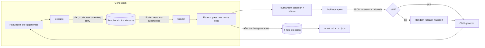

# evorg: self-evolving agent organizations

[](https://github.com/AkshayTallikar/evolving-agent-org/actions/workflows/ci.yml)

A team of LLM agents (planner, coder, tester, reviewer) solves coding tasks. An **architect
agent** reads how the team did and proposes a change to the team itself: add or drop a role,
rewrite an instruction, move a role to a bigger model, allow another retry. A benchmark
tournament with executed tests decides which version survives. Over generations the
organization redesigns itself, and every change is recorded with the architect's reason.

## The problem

Most multi-agent systems are designed by hand. Someone decides there should be a planner and
a reviewer, writes their prompts, and hopes the structure fits the work. Nobody measures
whether the reviewer earns its cost, or whether a prompt line is quietly making things worse.

evorg treats the organization as a genome and lets selection answer those questions:

- **Structure is searchable.** Roles, instructions, model tiers and retry budgets are all genes.
- **Fitness is measured, not judged.** Code is graded by running hidden tests, and cost
  counts against fitness (`fitness = pass rate - 10 x mean USD per task`).
- **Generalization is checked.** Four held-out tasks are never used for selection.
- **Every change is explained.** Lineage keeps what changed and why the architect proposed it.

## Architecture



| Module | What it does |
| --- | --- |
| `genome.py` | Immutable org genome, validation, content-hash id, diffs between genomes |
| `llm/` | `LLMBackend` protocol, an offline deterministic simulator, and an Anthropic backend |
| `bench/` | 12 small Python tasks with visible and hidden tests, and a subprocess grader |
| `executor.py` | Runs one organization on one task: planners, coder, then tester or reviewer, with retries on feedback |
| `mutation.py` | Seven mutation operators and the architect, which parses LLM output leniently |
| `evolution.py` | Tournament selection, elitism, an evaluation cache, held-out scoring |
| `crossover.py` | Role-aligned crossover between two organizations |
| `pareto.py` | NSGA-II style ranking on pass rate and cost |
| `report.py`, `cli.py` | Markdown run report and the `evorg` command |
| `web/` | FastAPI API and a React lineage explorer for saved runs |

The full design, with module contracts and the testing strategy, is in
[docs/design.md](docs/design.md).

## Run it

Needs Python 3.11 or newer.

```bash
git clone https://github.com/AkshayTallikar/evolving-agent-org.git
cd evolving-agent-org
pip install -e ".[dev]"

# evolve on the offline simulator (free, deterministic, a few seconds)
evorg run --backend sim --generations 8 --population 8 --seed 3

# score each genome over 3 simulator seeds (less luck, 3x the work)
evorg run --backend sim --generations 8 --population 8 --seed 3 --eval-seeds 3

# grade up to 4 tasks at once (about 1.9x faster on 4 cores, same results)
evorg run --backend sim --generations 8 --population 8 --seed 3 --workers 4

# re-render a saved run
evorg show runs/sim-seed3

# score one genome on a split
evorg bench examples/seed_genome.json --split holdout

pytest          # runs offline, no API key needed
```

To browse runs as a family tree, install the web extra and serve the runs folder. Click any
organization to see its roles, scores, the architect's reason for the change and the diff
from its parent:

```bash
pip install -e ".[web]"
evorg serve --runs-dir runs      # then open http://127.0.0.1:8000
```

To evolve with real Claude models (small tier is Haiku, large tier is Opus), install the extra
and set `ANTHROPIC_API_KEY`. This spends money, so the command refuses to start without `--yes`
and a `--max-usd` cap. The cap is enforced before every call, architect included. Estimate first:

```bash
pip install -e ".[anthropic]"
evorg estimate --generations 3 --population 4
evorg run --backend anthropic --generations 3 --population 4 --max-usd 5 --yes
```

## Demo

`evorg run --backend sim --generations 8 --population 8 --seed 3` starts from a single coder
and ends with a four-role team:

```
| generation | best fitness | best pass rate |
| 0          | 0.4996       | 50.0%          |
| 3          | 0.8502       | 87.5%          |
| 6          | 0.9768       | 100.0%         |

Best fitness: ▁▃▅▆▆▆███
Held-out (unseen simulator seed): seed 0.0% -> champion 75.0%
```

The lineage shows how it got there, including a mistake it recovered from:

```
2. generation 1, fitness 0.3590: coder: model -> large.
   Why: Run the coder role on the large tier to test the trade-off.
5. generation 4, fitness 0.8502: coder: + instruction 'Handle empty input explicitly.'
7. generation 6, fitness 0.5938: coder: + instruction 'Be brief and skip unnecessary checks.'
8. generation 7, fitness 0.9768: + role planner (planner).
   Why: Add a planner role to see whether it improves the outcome.
```

The harmful "be brief" gene hitchhiked into the champion. A planner added in the next
generation more than made up for it. The champion it saved is in
[examples/champion_seed3.json](examples/champion_seed3.json).

## Results, honestly

The headline numbers above come from one run. [scripts/robustness.py](scripts/robustness.py)
re-scores the champions of 10 runs on 20 simulator seeds they never saw:

|  | train tasks | held-out tasks |
| --- | --- | --- |
| seed genome (one coder) | 42.5% | 37.5% |
| champions, one scoring seed, scored in their own run | 88.8% | - |
| champions, one scoring seed, scored on fresh noise | 68.0% | 69.4% |
| champions, `--eval-seeds 3`, scored on fresh noise | **78.2%** | **73.9%** |

Evolution clearly works: champions roughly double the seed's held-out pass rate. With a single
scoring seed, part of the in-run score is luck, because selection fits that seed's noise.
Averaging each genome over three simulator seeds (`--eval-seeds 3`) cuts that gap and gives
champions that hold up better on unseen noise, at three times the evaluation cost.

Crossover (`--crossover-rate`, off by default) fixes a stall but doesn't help held-out tasks
yet. Over 10 seeds at population 8, mutation-only search stops finding new organizations
after about 18 distinct genomes. Running it for 24 generations instead of 8 still ends at
91.2% train. With crossover at rate 0.3, the same 8 generations explore 33 genomes and reach
100% train. Held-out pass rate stays at 60.0% either way, though four held-out tasks is too
few to see small differences ([scripts/compare_crossover.py](scripts/compare_crossover.py)).

Pareto selection (`--selection pareto`, off by default) ranks genomes by Pareto front on pass
rate and cost instead of by fitness. Over 10 seeds at population 8 and 8 generations
([scripts/compare_selection.py](scripts/compare_selection.py)), its champions cost less but pass
slightly fewer tasks. Mean held-out mean cost per task is $0.000215 against $0.000308 for scalar
selection, about 30% cheaper. Train pass rate is 85.0% against 88.8%, and held-out pass rate is
57.5% against 60.0%. The final frontier holds 5.6 genomes on average against 5.3. Pareto scored
higher on 2 seeds and lower on 3, so the held-out difference is within noise. The honest claim is
a cheaper champion for a small loss in pass rate.

Other patterns across seeds: champions almost always add a tester or reviewer and an
edge-case instruction. Neutral instructions like "keep functions under 30 lines" drift along
because nothing selects against them.

## Limits

- **The simulator is a hand-written capability model, not an LLM.** It rewards features chosen
  by hand (a tester, edge-case instructions, the large model). It shows that selection, mutation
  and bookkeeping work end to end. It says nothing about how real models behave. That is the
  milestone 2 experiment.
- **The grader is not a sandbox.** It runs generated code in an isolated Python subprocess
  with a timeout. Real-model runs should happen in a container.
- **Twelve tasks is small.** Enough to see selection pressure, not enough to make claims.

## How this was built

Planned and reviewed by Claude Opus, with Claude Haiku subagents writing most of the code.
Every module landed as its own issue and pull request, merged only after CI passed on
Python 3.11, 3.12 and 3.13. See the
[closed pull requests](https://github.com/AkshayTallikar/evolving-agent-org/pulls?q=is%3Apr+is%3Aclosed).

## Roadmap (milestone 2)

- [#10](https://github.com/AkshayTallikar/evolving-agent-org/issues/10) Evolve on real models
